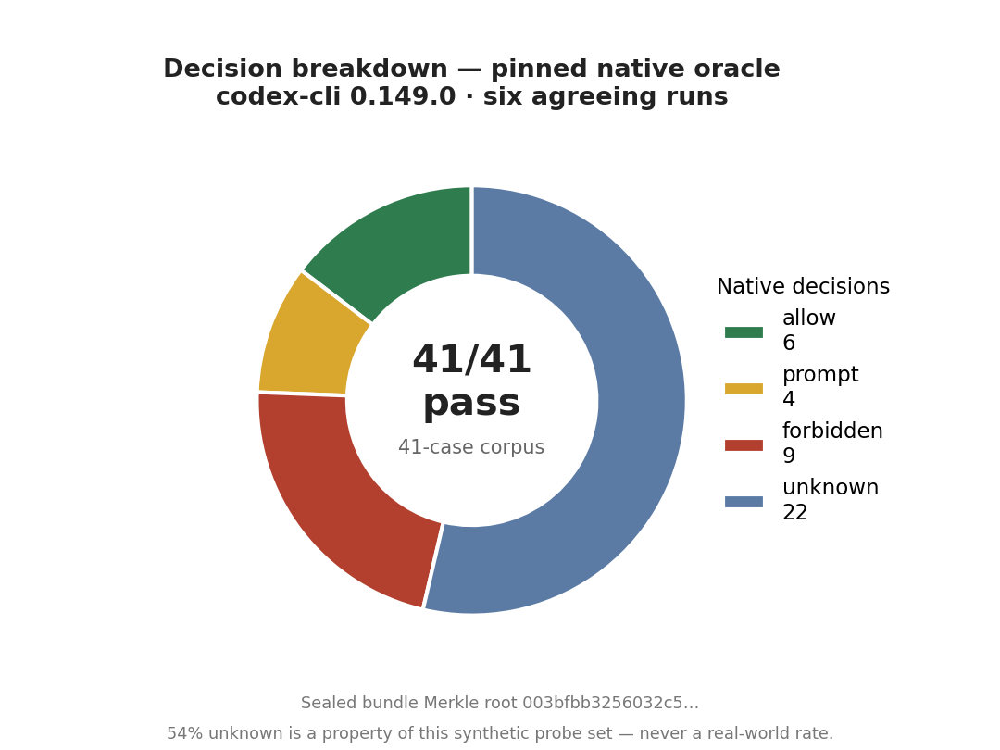
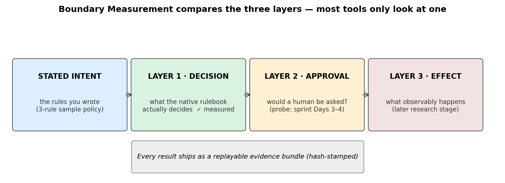
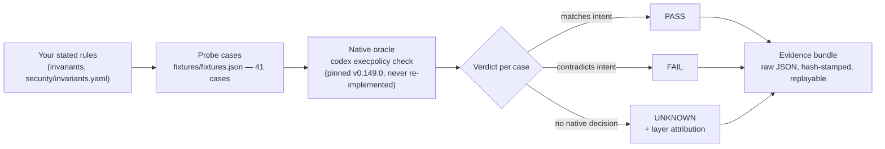

# Agent Boundary Conformance — the first instrument of **Boundary Measurement**

**Boundary Measurement** is the independent measurement of whether an AI agent's *enforced* limits match its *stated* limits. This repo is the first instrument: a local-first tester that takes a developer's written security rules for a coding agent, asks the agent's **own native policy checker** what it actually decides, and reports **pass / fail / unknown** with replayable evidence. It is not a scanner, not a firewall, and it never certifies anything as "secure."

**Status (Oct 21, 2026):** Day 1 of the Oct 21–27 sprint complete. Harness v0 works and is verified. The full living status lives in **[docs/DASHBOARD.md](docs/DASHBOARD.md)** — start there.

---

## 👀 Review this repo in 5 minutes

1. **See the result** — the chart below. 41 probe commands were replayed against Codex's own policy checker. Wherever the rulebook answers, we agree with it (41/41). The finding is how often it *doesn't answer*.
2. **Run it yourself** — one command, ~10 seconds: `python3 tools/run_fixtures.py` (needs the pinned `codex` CLI, v0.149.0). It prints the verdict table and writes raw evidence JSON to `evidence/reruns/`.
3. **Skim the evidence** — `evidence/day1-baseline-2026-10-21/` holds the frozen Day-1 raw outputs; `docs/COMPETITOR_BASELINES.md` shows the same tests run against the closest existing tools.
4. **Read the one-page status** — [docs/DASHBOARD.md](docs/DASHBOARD.md): objectives, the 5 invariants in plain English, the grants pipeline, the publish queue, and what's waiting on the founder.

## The Day-1 result

- **allow 6 · prompt 4 · forbidden 9 · unknown 22.** The 22 "unknowns" are cases where the written policy gives **no decision at all** — mostly ordinary variants (`rm -fr`, `rm --recursive --force`) and disguised forms (`bash -lc`, `env`, `sudo`, `timeout`, `xargs`) of the forbidden command.
- **"Unknown" is NOT a bypass.** It means the rules layer doesn't decide it; the agent's approval prompts and sandbox still govern what happens. That distinction is the credibility of this entire project and appears in every output.
- The corpus is deliberately weighted toward tricky variants to map coverage — **54% unknown is a property of this probe set, never a real-world rate.**

## How it works

Key verified mechanics: when several rules match one command, the **strictest decision wins**, regardless of order (verified six ways). Path forms flip with configuration (`/bin/rm -rf` is unknown by default, forbidden with `--resolve-host-executables`) — which is exactly why every result records its pinned configuration.

## Document map — what is current, what is history

| Document | Status | What it is |
|---|---|---|
| [docs/DASHBOARD.md](docs/DASHBOARD.md) | **CURRENT** | The living status page — read this first |
| [docs/COMPETITOR_BASELINES.md](docs/COMPETITOR_BASELINES.md) | CURRENT | Same tests, other tools (harness-eval, agent-security-harness, Snyk) |
| [docs/BOUNDARY_MEASUREMENT_FIELD.md](docs/BOUNDARY_MEASUREMENT_FIELD.md) | CURRENT | The field definition + the path to primary verifier |
| [docs/VERIFIABLE_EVIDENCE_ARCHITECTURE.md](docs/VERIFIABLE_EVIDENCE_ARCHITECTURE.md) | CURRENT | Event-sourced, Merkle-rooted, transparency-logged evidence design |
| [docs/METHODOLOGY_AND_GOVERNANCE.md](docs/METHODOLOGY_AND_GOVERNANCE.md) | CURRENT (draft for launch) | How measurements are made, disputed, corrected |
| [docs/WEEK1_BUILD_SPEC.md](docs/WEEK1_BUILD_SPEC.md) | CURRENT | The sprint spec + locked kill criterion |
| [security/invariants.yaml](security/invariants.yaml) | CURRENT (draft v0 — INV-004 decided Oct 21: Option A) | The 5 promises under test |
| [docs/daily/](docs/daily/) | DAILY LOG | One brief per sprint day; each is a snapshot of its day |
| [docs/DAY1_BASELINE_PLAN.md](docs/DAY1_BASELINE_PLAN.md) | HISTORICAL | The Day-1 plan (executed Oct 21) |
| [docs/DAY1_INVARIANT_REVIEW_PREP.md](docs/DAY1_INVARIANT_REVIEW_PREP.md) | HISTORICAL | Prep for the founder's invariant review |
| [docs/CATCH_UP_READING.md](docs/CATCH_UP_READING.md) | REFERENCE | The founder's reading plan for the field |
| [docs/IMPLEMENTATION_DESIGN.md](docs/IMPLEMENTATION_DESIGN.md) | REFERENCE | Stack design notes (Rust path, probe design) |

## Layout

`security/` the invariant contracts · `fixtures/` sample policies + the 41 probe cases · `tools/` the replay engine (stdlib-only, shells to the pinned native checker) · `evidence/` frozen run records + reruns · `docs/` status, baselines, designs.

**Kill criterion (locked):** by Day 7 (Oct 27) the sprint must show a useful result the baselines miss or explain poorly — or we stop, publish the negative result honestly, and offer the fixtures upstream.
