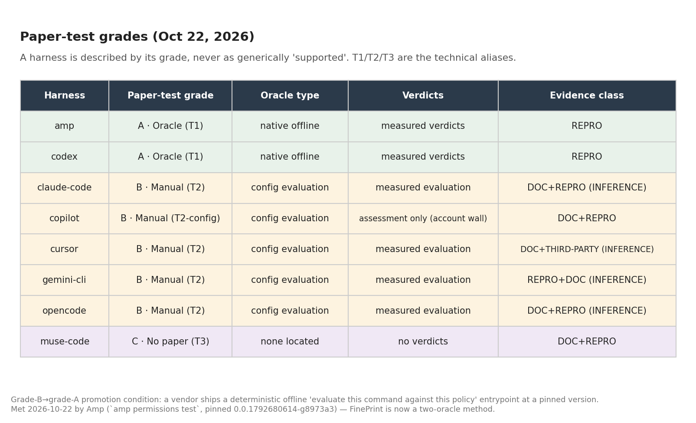
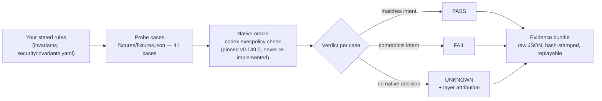

# Agent Boundary Conformance — the first instrument of **Boundary Measurement**

**Boundary Measurement** is the independent measurement of whether an AI agent's *enforced* limits match its *stated* limits. Think of it as a **building inspector** for agent policies: the inspector doesn't declare the building safe or unsafe — she checks the building against the code its owner filed, item by item, and writes down what matches and what doesn't. This repo is the first instrument: a local-first tester that takes a developer's written security rules for a coding agent, asks the agent's **own native policy checker** what it actually decides, and reports **pass / fail / unknown** with replayable evidence. It is not a scanner, not a firewall, and it never certifies anything as "secure."

**Status (Oct 21, 2026):** sprint complete — verdict **NARROW**. The repo stands as a Codex-T1 conformance *method* with its limitations on its face, not as an Index. All evidence below is pre-fix and labelled as such (the Day-5 proposed fix awaits the founder's approval). The full living status lives in **[docs/DASHBOARD.md](docs/DASHBOARD.md)** — start there.

---

## 👀 Review this repo in 5 minutes

1. **See the result** — the chart below. 41 probe commands were replayed against Codex's own policy checker. Measurement validity 41/41 — every native decision reproduced exactly. But measurement is not protection: intent coverage is a separate judgment (10 satisfied · 23 unresolved · 8 not applicable, of 41 — separate denominator). A correctly reported unknown is a successful measurement, never a satisfied protective intent. The finding is how often the rulebook *doesn't answer*.
2. **Run it yourself** — one command, ~10 seconds: `python3 tools/run_fixtures.py` (needs the pinned `codex` CLI, v0.149.0). It prints the verdict table and writes raw evidence JSON to `evidence/reruns/`.
3. **Skim the evidence** — `evidence/day1-baseline-2026-10-21/` holds the frozen Day-1 raw outputs; `docs/COMPETITOR_BASELINES.md` shows the same tests run against the closest existing tools.
4. **Read the one-page status** — [docs/DASHBOARD.md](docs/DASHBOARD.md): objectives, the 5 invariants in plain English, the grants pipeline, the publish queue, and what's waiting on the founder.

## The sprint result (PRE-FIX evidence — the Day-5 fix is unapproved, unapplied)

- **allow 6 · prompt 4 · forbidden 9 · unknown 22.** The 22 "unknowns" are cases where the written policy gives **no decision at all** — mostly ordinary variants (`rm -fr`, `rm --recursive --force`) and disguised forms (`bash -lc`, `env`, `sudo`, `timeout`, `xargs`) of the forbidden command.
- Six independent runs agree byte-identically on the native decisions — the chart is read from the sealed Day-6 bundle, not hand-typed. Measurement validity 41/41; intent coverage 10 satisfied · 23 unresolved · 8 not applicable (of 41), under a separate denominator. An 11-case protected-records family: measurement 11/11 PASS, intent 3 satisfied · 8 unresolved (of 11); 4/4 negative controls stay healthy.
- **"Unknown" is NOT a bypass.** It means the rules layer doesn't decide it; the agent's approval prompts and sandbox still govern what happens. That distinction is the credibility of this entire project and appears in every output.
- The corpus is deliberately weighted toward tricky variants to map coverage — **54% unknown is a property of this probe set, never a real-world rate.**

## How it works

The project is a **harness-neutral framework** with labelled adapters, not a single-harness tool. Five harnesses are in scope: **Codex** is measured at T1 (native oracle, pinned codex-cli 0.149.0); **Claude Code, Cursor, Gemini CLI, and OpenCode** sit at T2 (config evaluation from documented semantics — no measured verdicts yet). No harness is described as generically "supported" — it is described by its tier.

Key verified mechanics: when several rules match one command, the **strictest decision wins**, regardless of order (verified six ways). Path forms flip with configuration (`/bin/rm -rf` is unknown by default, forbidden with `--resolve-host-executables`) — which is exactly why every result records its pinned configuration.

## Document map — what is current, what is history

| Document | Status | What it is |
|---|---|---|
| [docs/DASHBOARD.md](docs/DASHBOARD.md) | **CURRENT** | The living status page — read this first |
| [docs/EXPLAINER.md](docs/EXPLAINER.md) | CURRENT | **Start here if the idea is new to you** — the full plain-language foundation (the building-inspector metaphor, policy, conformance, the first measurement, the sprint-end verdict) |
| [docs/FRAMEWORK.md](docs/FRAMEWORK.md) | **CURRENT** | The harness-neutral framework: invariant schema, adapter contract, the T1/T2/T3 tiers, the five-harness matrix + surveyed field |
| [docs/HARNESS_TIERS.md](docs/HARNESS_TIERS.md) | CURRENT | The tier assignments with the evidence behind each (Codex T1 measured; four T2; the T2→T1 promotion condition) |
| [docs/LIMITATIONS.md](docs/LIMITATIONS.md) | **CURRENT** | What the evidence does NOT support — read before citing any result |
| [docs/COMPETITOR_BASELINES.md](docs/COMPETITOR_BASELINES.md) | CURRENT | Same tests, other tools (harness-eval, agent-security-harness, Snyk) |
| [docs/COMPETITIVE_EVIDENCE_MATRIX.md](docs/COMPETITIVE_EVIDENCE_MATRIX.md) | CURRENT | 41 fixtures × tools matrix + Day-7 re-verification addendum |
| [docs/SCIENTIFIC_REVIEW_ADDENDUM.md](docs/SCIENTIFIC_REVIEW_ADDENDUM.md) | CURRENT | The narrowed novelty claim, GuardFall, and the research upgrades adopted in v1.1 |
| [docs/BOUNDARY_MEASUREMENT_FIELD.md](docs/BOUNDARY_MEASUREMENT_FIELD.md) | CURRENT | The field definition + the path to primary verifier |
| [docs/VERIFIABLE_EVIDENCE_ARCHITECTURE.md](docs/VERIFIABLE_EVIDENCE_ARCHITECTURE.md) | CURRENT | Event-sourced, Merkle-rooted, transparency-logged evidence design + the Oct 21 adopt-now addendum |
| [docs/METHODOLOGY_AND_GOVERNANCE.md](docs/METHODOLOGY_AND_GOVERNANCE.md) | CURRENT (draft for launch) | How measurements are made, disputed, corrected |
| [docs/WEEK1_BUILD_SPEC.md](docs/WEEK1_BUILD_SPEC.md) | CURRENT | The sprint spec + locked kill criterion |
| [docs/EXPLAINER.md](docs/EXPLAINER.md) | CURRENT | **Start here if the idea is new to you** — the full plain-language foundation: policy, declarative policy, why defaults aren't enough, conformance, the test setup, and the references |
| [security/invariants.yaml](security/invariants.yaml) | CURRENT (draft v0 — INV-004 decided Oct 21: Option A) | The 5 promises under test |
| [schemas/](schemas/) | CURRENT | Versioned schemas: invariant v1, finding v1 + v2 (dual-verdict extension), evidence-bundle v1 + serialization guards |
| [docs/preregistration/](docs/preregistration/) | CURRENT | Hash-locked pre-registration of the Day-2 run (corpus, thresholds, inclusion rules). Correction Oct 21: Day 1 was exploratory; Day 2 pre-registered a CONFIRMATION/replication of the explored hypothesis, not initial discovery (held-out: stratified alternation) |
| [docs/daily/](docs/daily/) | DAILY LOG | One brief per sprint day; each is a snapshot of its day |
| [evidence/reports/day6-scorecard/](evidence/reports/day6-scorecard/) | CURRENT | The Boundary Scorecard (PRE-FIX): `scorecard.json`/`scorecard.html` + `tier-matrix.json` — the shareable-first export |
| [evidence/reports/day2-41-corpus/](evidence/reports/day2-41-corpus/) | CURRENT | Standalone deterministic report of the 41-case corpus (`report.json`/`report.html`) |
| [docs/DAY1_BASELINE_PLAN.md](docs/DAY1_BASELINE_PLAN.md) | HISTORICAL | The Day-1 plan (executed Oct 21) |
| [docs/DAY1_INVARIANT_REVIEW_PREP.md](docs/DAY1_INVARIANT_REVIEW_PREP.md) | HISTORICAL | Prep for the founder's invariant review |
| [docs/CATCH_UP_READING.md](docs/CATCH_UP_READING.md) | REFERENCE | The founder's reading plan for the field |
| [docs/IMPLEMENTATION_DESIGN.md](docs/IMPLEMENTATION_DESIGN.md) | REFERENCE | Stack design notes (Rust path, probe design) |

## Layout

`security/` the invariant contracts · `fixtures/` sample policies + the 41 probe cases · `tools/` the replay engine (stdlib-only, shells to the pinned native checker) · `evidence/` frozen run records + reruns · `docs/` status, baselines, designs.

**Kill criterion (locked) — verdict delivered:** by Day 7 (Oct 27) the sprint had to show a useful result the baselines miss or explain poorly — or stop, publish the negative result honestly, and offer the fixtures upstream. **Verdict: NARROW** (see [docs/daily/2026-10-27.md](docs/daily/2026-10-27.md)): the method is proven on Codex T1 evidence; a public multi-harness Index is not earned on one measured harness. The repo stands as the method, limitations on its face.
