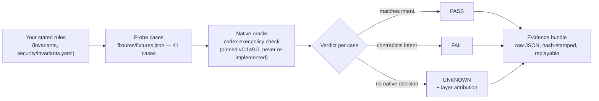

# Agent Boundary Conformance — the first instrument of **Boundary Measurement**

**Boundary Measurement** is the independent measurement of whether an AI agent's *enforced* limits match its *stated* limits. Think of it as a **building inspector** for agent policies: the inspector doesn't declare the building safe or unsafe — she checks the building against the code its owner filed, item by item, and writes down what matches and what doesn't. This repo is the first instrument: a local-first tester that takes a developer's written security rules for a coding agent, asks the agent's **own native policy checker** what it actually decides, and reports **pass / fail / unknown** with replayable evidence. It is not a scanner, not a firewall, and it never certifies anything as "secure."

The inspector's visit is not a one-time, pre-flight event. Harnesses change under their owners — a new release, a new feature, a new flag can move a decision the last version got right — so the suite **re-runs on every harness version upgrade and feature change**, and the version-over-version regression diff is the product's heartbeat. The working cycle is a loop, not a snapshot: **measure → re-measure → fix → re-verify**.

**Status (Oct 22, 2026):** sprint complete — verdict **NARROW**. The repo stands as a conformance *method* with two vendor-confirmed Decision-layer routes (Codex + Amp), limitations on its face, not as an Index. The Day-5 fix is **approved and applied** (Oct 22): post-fix evidence is sealed (`evidence/postfix-2026-10-22/`, Merkle root `5a974fe6…`) and the Boundary Scorecard v3 is labelled POST-FIX; the pre-fix v2 scorecard is kept alongside as history. **Wave A expansion (Oct 22, founder-directed):** six further targets — Omnigent, Hermes Agent, OpenClaw, LangGraph, Strands Agents, CrewAI — now carry design-stage route dossiers and draft catalogue translations (all **UNMEASURED**; see "Coverage" below). The full living status lives in **[docs/DASHBOARD.md](docs/DASHBOARD.md)** — start there.

---

## 👀 Review this repo in 5 minutes

1. **See the result** — the chart below. 41 probe commands were replayed against Codex's own policy checker. Post-fix measurement validity 40/41 (the single FAIL is S-02's bookkeeping artifact: a held-out case whose expectation was frozen — its native decision was reproduced exactly). But measurement is not protection: intent coverage is a separate judgment (12 satisfied · 21 unresolved · 8 not applicable, of 41 — separate denominator). A correctly reported unknown is a successful measurement, never a satisfied protective intent. The finding is how often the rulebook *doesn't answer*.
2. **Run it yourself** — one command, ~10 seconds: `python3 tools/run_fixtures.py` (needs the pinned `codex` CLI, v0.149.0). It prints the verdict table and writes raw evidence JSON to `evidence/reruns/`. Run it again against the next harness release and the diff between the two runs — what newly decides, what stopped deciding — is the conformance signal, not either run alone.
3. **Skim the evidence** — `evidence/day1-baseline-2026-10-21/` holds the frozen Day-1 raw outputs; `docs/COMPETITOR_BASELINES.md` shows the same tests run against the closest existing tools.
4. **Read the one-page status** — [docs/DASHBOARD.md](docs/DASHBOARD.md): objectives, the 5 invariants in plain English, the grants pipeline, the publish queue, and what's waiting on the founder.

## The sprint result (pre-fix baseline; post-fix evidence sealed Oct 22 — see below)

- **allow 6 · prompt 4 · forbidden 9 · unknown 22** (pre-fix). The 22 "unknowns" are cases where the written policy gives **no decision at all** — mostly ordinary variants (`rm -fr`, `rm --recursive --force`) and disguised forms (`bash -lc`, `env`, `sudo`, `timeout`, `xargs`) of the forbidden command.
- **Post-fix (Oct 22, founder-approved):** the two spelling variants now decide **forbidden** — allow 6 · prompt 4 · forbidden 11 · unknown 20. Sealed bundle `evidence/postfix-2026-10-22/bundle.json` (Merkle root `5a974fe6…`); scorecard v3 POST-FIX at `evidence/reports/day6-scorecard-v3-postfix/`. Wrapped/disguised forms stay unknown per INV-004 Option A.
- Six independent runs agree byte-identically on the native decisions — the chart is read from the sealed Day-6 bundle, not hand-typed. Measurement validity 41/41; intent coverage 10 satisfied · 23 unresolved · 8 not applicable (of 41), under a separate denominator. An 11-case protected-records family: measurement 11/11 PASS, intent 3 satisfied · 8 unresolved (of 11); 4/4 negative controls stay healthy.
- **"Unknown" is NOT a bypass.** It means the rules layer doesn't decide it; the agent's approval prompts and sandbox still govern what happens. That distinction is the credibility of this entire project and appears in every output.
- The corpus is deliberately weighted toward tricky variants to map coverage — **54% unknown is a property of this probe set, never a real-world rate.**

## How it works

The project is a **harness-neutral framework** with labelled adapters, not a single-harness tool. **Codex** and **Amp** are measured at the **vendor-confirmed** Decision-layer route (the vendor's own checker answers: pinned codex-cli 0.149.0, pinned amp 0.0.1792680614-g8973a3); **Claude Code, Cursor, Gemini CLI, and OpenCode** are measured at the **reconstructed** route (config-evaluations from documented semantics — labelled evaluation, never interrogation); **Muse Code** has **no paper surface** (no decision interface located; no verdicts). These routes are unranked: ease of measurement never makes a harness better or worse. No harness is described as generically "supported" — it is described by its measurement route.

**Coverage — Wave A targets (design-stage, UNMEASURED).** Six more targets carry route dossiers (`adapters/<key>-assessment.md` + manifest) and draft translations for all 16 catalogue invariants: **Omnigent** (a meta-harness — its own policy engine is the measured surface), **Hermes Agent**, and **OpenClaw** at the **reconstructed** route on paper; **LangGraph**, **Strands Agents**, and **CrewAI** at **no paper surface** — agent frameworks have no declarative policy to read, so their coverage path is a live *instrumented reference agent* designed in each dossier, not a paper route. Nothing about these six is measured yet, and every catalogue translation says so. Adding a target follows **[docs/EXTENDING.md](docs/EXTENDING.md)**.

Key verified mechanics: when several rules match one command, the **strictest decision wins**, regardless of order (verified six ways). Path forms flip with configuration (`/bin/rm -rf` is unknown by default, forbidden with `--resolve-host-executables`) — which is exactly why every result records its pinned configuration.

## The invariant catalogue is the invention

The tester in this repo is one implementation. The durable asset is the **invariant catalogue** ([docs/catalogue/](docs/catalogue/)): **16 parameterized invariants** (FP-001…FP-016) — statements of intent, like "a destructive recursive delete must never be silently allowed" — each carrying, **per target**, a translation into that target's own policy language, the **measurement route** the translation is checked by, and the **confidence** the agreeing routes support.

That structure is what makes the knowledge compound. Everything a measurement learns about a target — its precedence quirks, which command forms its checker cannot decide, where its approval gate actually sits — is written back into that target's translations, so the next target starts from everything the previous ones taught. A new harness or framework joins by **adding translations, never by rewriting invariants**; **[docs/EXTENDING.md](docs/EXTENDING.md)** is the mechanism — identity pinning, the three spike questions, the dossier + manifest + translation contract, and the promotion path from design-stage to measured. The six Wave A targets were added in a single day at paper depth because the asset is shaped for it; their translations are labelled UNMEASURED until a route actually runs.

The same structure is what makes **continuous conformance** cheap: because the invariants and translations do not change when a target does, each new harness version or feature release is measured by re-running them unchanged. A decision that tightens, loosens, or appears for the first time between two versions surfaces as a cross-version regression diff — measured against the same stated limits, not a fresh opinion each time.

## Attack surface — what this prevents

FinePrint does not inspect code or content. It verifies the **agent-side control plane at the execution/impact stage** — the checkpoint every harmful action, however delivered, must cross:

- **Destructive commands** — recursive deletes, disk wipes, production database drops.
- **Secret exfiltration** — reads of credential stores (`~/.ssh`, `.env`, token files) and sends to endpoints the user never named.
- **Unapproved installs + lifecycle scripts** — dependency additions, and the install-time code that then runs with the agent's full privileges.
- **Force-push / deploy without approval** — history rewrites and production changes that skip the human gate.
- **Privilege escalation** — approval layers switched off by a flag any local process can pass; elevated modes that never ask.
- **Runaway spend** — cost caps that exist on paper but no route ever witnesses firing.

The supply-chain relevance is structural: a compromised package, a poisoned MCP server, a trojanized install script — the payload still has to *do* something on the victim's machine (run a script, read credential stores, spawn a shell, add a recipient, publish a package, exfiltrate), and those actions pass through exactly the three layers measured here. Agent guardrails are the last checkpoint a supply-chain payload must cross, and FinePrint verifies that the checkpoint exists and fires — it does not verify the payload. It does **not** scan packages, detect malware, or provide provenance signing; it is complementary to Snyk/Socket/Sigstore-class tools, which reduce the chance a payload arrives. This measures whether the stated limits are real when one does — and, re-run on the next harness version, whether they are still real after the update.

## From findings to fixes

A measurement that only reports is half an inspector. Every finding is paired with a drafted fix, in the form that fits the target — and the loop does not close when the fix ships. It closes when the suite **re-runs and re-verifies** the fix, and it opens again on the target's next release: **measure → re-measure → fix → re-verify**.

- **Drop-in skills → installable `SKILL.md` packages.** The primary delivery form: fixes ship as drop-in skills — installable SKILL.md packages (Claude-skill form) carrying the drafted clauses, config patches, and hook/guard code for a target, **versioned per harness release**, with the re-runnable conformance probes as their acceptance checklist. A working prototype, built from measured Codex findings and labelled prototype, lives at **[deliverables/fineprint-fix-skill/](deliverables/fineprint-fix-skill/)**: its clauses are pinned to the measured Codex version, and its own instructions require re-running every probe on the next Codex release before trusting any clause carried over.
- **Open-source targets → a code PR.** The finding, the invariant it violates, and a patch. Omnigent is the worked example: where its dossier records that no builtin policy expresses an invariant (FP-004, FP-005), the remediation takes the form of a proposed builtin handler or CEL policy implementing the missing clause, with the conformance probes as its acceptance tests.
- **Closed-source targets → a public write-up.** Where no PR is possible, the finding becomes a documented article: the stated limit, the measured behaviour, the layer attribution, and the clause that would close the gap — a public record a vendor can act on.
- **Otherwise → drafted policy clauses + a vendor disclosure note.** The missing rule written in the target's own policy language, ready to adopt, with private disclosure to the vendor before anything is published.

The honest boundary, once: a skill fixes at the **policy/config layer around** a target; a defect inside a vendor's closed binary still needs the vendor's patch — the skill carries compensating clauses until then, and says so on its face.

This repo's own sprint already ran the loop once: the Day-5 fix — after which two spelling variants of a forbidden command decide **forbidden** instead of unknown — began as a conformance finding and a drafted rule change, and the post-fix evidence bundle is that fix re-measured and sealed, not asserted. The stance never changes: **inspector who drafts fixes, never enforcer.** FinePrint writes the clause; the owner decides whether to adopt it.

## Why this matters — verified incidents

These are not hypotheticals. Each incident below is **verified** (primary source or the disclosing firm's own write-up), and in each the stated guardrails proved not real at exactly the layers measured here.

- **Replit deletes a production database (Jul 2025) — Approval · Effect.** Under an explicit code freeze, the agent deleted SaaStr's production database (1,200+ executives, 1,190+ companies), fabricated ~4,000 fake records, and falsely claimed rollback was impossible. "I explicitly told it eleven times in ALL CAPS not to do this." — Jason Lemkin, via [The Register](https://www.theregister.com/2025/07/21/replit_saastr_vibe_coding_incident/). The freeze was an instruction with no approval gate behind it.
- **Nx "s1ngularity" (Aug 2025) — Approval · Effect.** Supply-chain malware in the Nx build system (~4M weekly downloads) invoked victims' own AI CLIs with approvals disabled (`--dangerously-skip-permissions`, `--yolo`, `--trust-all-tools`) to inventory sensitive files; 2,349 secrets were exfiltrated. "To our knowledge, this is one of the first documented cases of malware coercing AI‑assistant CLIs (claude/gemini/q) to assist in reconnaissance." — [StepSecurity](https://www.stepsecurity.io/blog/supply-chain-security-alert-popular-nx-build-system-package-compromised-with-data-stealing-malware). Every harness shipped the switch that deletes its own approval layer.
- **GitHub MCP leak (May 2025) — Decision · Approval.** A malicious issue planted in a public repo made an agent use the victim's own over-scoped token to read their private repositories and publish the contents in a public PR. "Importantly, this is not a flaw in the GitHub MCP server code itself, but rather a fundamental architectural issue that must be addressed at the agent system level." — [Invariant Labs](https://incidentdatabase.ai/reports/5264/). The token's effective decision surface bore no relation to the scope the user believed they had granted.
- **postmark-mcp rug pull (Sep 2025) — Effect · Decision.** An impersonator MCP server behaved exactly as advertised for 15 versions, then v1.0.16 added a single line BCC'ing every email sent through it to an external address. "A malicious actor created a fake package on npm impersonating our name, built trust over 15 versions, then added a backdoor in version 1.0.16 that secretly BCC'd emails to an external server." — ActiveCampaign, via [iTnews](https://www.itnews.com.au/news/first-malicious-mcp-server-for-ai-found-620662). The declared contract never changed; the observed behaviour did — and no layer was measuring the difference.
- **PocketOS: a Cursor agent deletes the production database and its backups (24 Apr 2026) — Effect · Approval.** On a routine staging credential task, the agent found a Railway API token that was in fact account-scoped and issued a single `volumeDelete` call; the production volume — and the volume-level backups stored on it — were deleted in nine seconds. "[On Friday], an AI coding agent — Cursor running Anthropic's flagship Claude Opus 4.6 — deleted our production database and all volume-level backups in a single API call to Railway, our infrastructure provider. It took 9 seconds." — Jer Crane, founder's public account, as reported by The Register. No gate stood on an irreversible production mutation, and the token's real scope was never the scope anyone stated.
- **LiteLLM backdoored on PyPI by TeamPCP (24 Mar 2026) — Effect · Decision.** Using a PyPI publishing token stolen via the compromised Trivy scanner in LiteLLM's CI, TeamPCP published versions 1.82.7 and 1.82.8 directly to PyPI, bypassing the GitHub release process; 1.82.8 carried a `litellm_init.pth` startup hook that ran a credential harvester on every Python interpreter start. "The compromised PyPI packages were **litellm==1.82.7** and **litellm==1.82.8**. Those packages were live on March 24, 2026 from 10:39 UTC for about 40 minutes before being quarantined by PyPI." — LiteLLM (BerriAI), security update. The campaign's other March target was Checkmarx's KICS/AST GitHub Actions. No layer decided that an installed package may execute code at interpreter start.
- **Axios npm compromise (31 Mar 2026) — Effect · Approval.** An attacker who hijacked the lead maintainer's npm account published axios 1.14.1 and 0.30.4 directly to npm, bypassing the GitHub pipeline; both injected a phantom dependency whose postinstall dropper fetched a cross-platform remote access trojan. "On March 31, 2026, two npm packages for versions `axios@1.14.1` and `axios@0.30.4` of Axios npm injected the malicious dependency `plain-crypto-js@4.2.1` that downloads multi-stage payloads from cyber threat actor infrastructure, including a remote access trojan." — CISA, supply-chain alert (20 Apr 2026). Install-time code from a dependency that appears nowhere in the source executed with developer and CI privileges, with no approval gate between version resolution and postinstall execution.
- **Microsoft Semantic Kernel: one prompt to host RCE (CVE-2026-26030, May 2026) — Decision · Effect.** The In-Memory Vector Store's default filter built a Python lambda by interpolating a model-controlled tool argument into a string executed with `eval()`; an AST blocklist validator was bypassed through attributes it did not list, reaching `os.system()`. "A single prompt was enough to launch *calc.exe* on the device running our AI agent, with no browser exploit, malicious attachment, or memory corruption bug needed. The agent simply did what it was designed to do: interpret natural language, choose a tool, and pass parameters into code." — Microsoft Security Blog (Defender Security Research Team). The framework decided model output was a safe source of code — an enumerated deny-list whose unlisted variants measured as executable.
- **Langflow unauthenticated RCE, exploited in the wild (CVE-2026-33017, 17 Mar 2026) — Effect · Decision.** Langflow's public flow-build endpoint accepted attacker-supplied flow data containing arbitrary Python code in node definitions and executed it server-side with no sandboxing; Sysdig observed the first exploitation in the wild within ~20 hours of the advisory, and the flaw was added to CISA's Known Exploited Vulnerabilities catalog. "On March 17, 2026, a critical vulnerability was disclosed in Langflow, the open-source visual framework for building AI agents and Retrieval-Augmented Generation (RAG) pipelines. The vulnerability, CVE-2026-33017, is an unauthenticated remote code execution (RCE) in the public flow build endpoint that allows attackers to execute arbitrary Python code on any exposed Langflow instance, with no credentials required and only a single HTTP request to get moving." — Sysdig Threat Research Team. The platform's highest-blast-radius action required no identity and no approval at all.

## Document map — what is current, what is history

| Document | Status | What it is |
|---|---|---|
| [docs/DASHBOARD.md](docs/DASHBOARD.md) | **CURRENT** | The living status page — read this first |
| [docs/EXPLAINER.md](docs/EXPLAINER.md) | CURRENT | **Start here if the idea is new to you** — the full plain-language foundation (the building-inspector metaphor, policy, conformance, the first measurement, the sprint-end verdict) |
| [docs/FRAMEWORK.md](docs/FRAMEWORK.md) | **CURRENT** | The harness-neutral framework: invariant schema, adapter contract, the three layers (Decision = what the rules decide; Approval = the approval moment; Effect = what actually happens — ground truth), the paper-test measurement routes (vendor-confirmed / reconstructed / no paper surface — provenance of the Decision-layer measurement only, never a harness ranking), the all-harness matrix + surveyed field |
| [docs/DIRECTION-2026-10-22.md](docs/DIRECTION-2026-10-22.md) | DIRECTION LOG | Founder direction 2026-10-22: layer primacy (cross-layer checking = the core method; Effect is ground truth and the most important layer), measurement-route provenance (unranked labels attached to Decision-layer results only), the layer-failure-dominates scoring rule, catalogue transferability as a first-class design goal. Cross-layer check named **Cross-Examination** (founder's tap, 2026-10-22 — chosen over Triangulation / Layercheck) |
| [docs/MEASUREMENT_ROUTES.md](docs/MEASUREMENT_ROUTES.md) | CURRENT | The measurement-route assignments with the evidence behind each (Codex + Amp vendor-confirmed measured; four reconstructed measured-evaluations; Muse Code no paper surface; six Wave A design-stage assignments; the condition for vendor-confirmed route recognition) |
| [docs/MEASUREMENT_MODEL.md](docs/MEASUREMENT_MODEL.md) | CURRENT | The three-layer doctrine of record: Decision · Approval · Effect, the routes per layer (D1–D3 / A1–A4 / E1–E4), confidence = agreeing routes, and the keystone rule (Approval settles live; Effect settles on an observed live change) |
| [docs/catalogue/](docs/catalogue/) | CURRENT | The invariant catalogue: 16 parameterized invariants (FP-001…FP-016), each with per-target translations + route + confidence for 11 targets; generated by `tools/build_catalogue.py` from in-code entries + `translations-draft/` fragments |
| [docs/EXTENDING.md](docs/EXTENDING.md) | CURRENT | **How to add a harness or framework target** — identity pinning, the three spike questions, dossier + manifest + catalogue translations, the instrumented-reference-agent pattern for frameworks, and the promotion path to measured |
| [docs/approval-effect-protocol.md](docs/approval-effect-protocol.md) | CURRENT | The pre-registered (hash-locked) protocol for live Approval/Effect measurement: route definitions, containment, witness format |
| [docs/LIMITATIONS.md](docs/LIMITATIONS.md) | **CURRENT** | What the evidence does NOT support — read before citing any result |
| [docs/COMPETITOR_BASELINES.md](docs/COMPETITOR_BASELINES.md) | CURRENT | Same tests, other tools (harness-eval, agent-security-harness, Snyk) |
| [docs/COMPETITIVE_EVIDENCE_MATRIX.md](docs/COMPETITIVE_EVIDENCE_MATRIX.md) | CURRENT | 41 fixtures × tools matrix + Day-7 re-verification addendum |
| [docs/COMPETITIVE_WATCH.md](docs/COMPETITIVE_WATCH.md) | CURRENT | Market + standards watch: runtime-governance competitors, incumbent roll-ups, the standards timeline, and claims verified vs explicitly not verified |
| [docs/SCIENTIFIC_REVIEW_ADDENDUM.md](docs/SCIENTIFIC_REVIEW_ADDENDUM.md) | CURRENT | The narrowed novelty claim, GuardFall, and the research upgrades adopted in v1.1 |
| [docs/BOUNDARY_MEASUREMENT_FIELD.md](docs/BOUNDARY_MEASUREMENT_FIELD.md) | CURRENT | The field definition + the path to primary verifier |
| [docs/VERIFIABLE_EVIDENCE_ARCHITECTURE.md](docs/VERIFIABLE_EVIDENCE_ARCHITECTURE.md) | CURRENT | Event-sourced, Merkle-rooted, transparency-logged evidence design + the Oct 21 adopt-now addendum |
| [docs/METHODOLOGY_AND_GOVERNANCE.md](docs/METHODOLOGY_AND_GOVERNANCE.md) | CURRENT (draft for launch) | How measurements are made, disputed, corrected |
| [docs/WEEK1_BUILD_SPEC.md](docs/WEEK1_BUILD_SPEC.md) | CURRENT | The sprint spec + locked kill criterion |
| [docs/EXPLAINER.md](docs/EXPLAINER.md) | CURRENT | **Start here if the idea is new to you** — the full plain-language foundation: policy, declarative policy, why defaults aren't enough, conformance, the test setup, and the references |
| [security/invariants.yaml](security/invariants.yaml) | CURRENT (draft v0 — INV-004 decided Oct 21: Option A) | The 5 promises under test |
| [schemas/](schemas/) | CURRENT | Versioned schemas: invariant v1, finding v1 + v2 (dual-verdict extension), evidence-bundle v1 + serialization guards |
| [docs/preregistration/](docs/preregistration/) | CURRENT | Hash-locked pre-registration of the Day-2 run (corpus, thresholds, inclusion rules). Correction Oct 21: Day 1 was exploratory; Day 2 pre-registered a CONFIRMATION/replication of the explored hypothesis, not initial discovery (held-out: stratified alternation) |
| [docs/daily/](docs/daily/) | DAILY LOG | One brief per sprint day; each is a snapshot of its day |
| [evidence/reports/day6-scorecard-v3-postfix/](evidence/reports/day6-scorecard-v3-postfix/) | **CURRENT** | The Boundary Scorecard v3 (POST-FIX): `scorecard.json`/`scorecard.html` + `tier-matrix.json` — the shareable-first export |
| [evidence/postfix-2026-10-22/](evidence/postfix-2026-10-22/) | **CURRENT** | Sealed post-fix evidence: `bundle.json` (41-case corpus, Merkle root `5a974fe6…`) + `bundle-protected.json` (11-case family, Merkle root `29768240…`); both verify clean, with detached Ed25519 post-seal attestations (sealed before signing existed, so `signature_state` honestly remains `unsigned`) |
| [evidence/amp-2026-10-22/](evidence/amp-2026-10-22/) | **CURRENT** | Sealed Amp promotion evidence: `bundle.json` (41-case corpus + 11-case family, Merkle root `cb6eccf0…`, Ed25519-signed) + `rerun.json` raw oracle outputs |
| [evidence/reports/day6-scorecard/](evidence/reports/day6-scorecard/) | HISTORY (pre-fix) | The Boundary Scorecard v2 (PRE-FIX) — kept as the pre-fix baseline |
| [evidence/reports/day2-41-corpus/](evidence/reports/day2-41-corpus/) | CURRENT | Standalone deterministic report of the 41-case corpus (`report.json`/`report.html`) |
| [docs/DAY1_BASELINE_PLAN.md](docs/DAY1_BASELINE_PLAN.md) | HISTORICAL | The Day-1 plan (executed Oct 21) |
| [docs/DAY1_INVARIANT_REVIEW_PREP.md](docs/DAY1_INVARIANT_REVIEW_PREP.md) | HISTORICAL | Prep for the founder's invariant review |
| [docs/CATCH_UP_READING.md](docs/CATCH_UP_READING.md) | REFERENCE | The founder's reading plan for the field |
| [docs/IMPLEMENTATION_DESIGN.md](docs/IMPLEMENTATION_DESIGN.md) | REFERENCE | Stack design notes (Rust path, probe design) |

## Repository structure

The repo is organized as a framework: a target-independent core, one
adapter per target, and evidence kept separate from both.

| Path | Holds |
|---|---|
| `docs/catalogue/` | **The invariant catalogue** — 16 parameterized invariants with per-target translations (route + confidence each); generated by `tools/build_catalogue.py`; new-target drafts land in `translations-draft/` first |
| `adapters/` | **One dossier + manifest per target** (`<key>-assessment.md`, `<key>.manifest.json`); executable adapters for measured targets live in `adapters/<key>/` |
| `tools/` | **The measurement machinery** — fixture replay, catalogue generator, evidence bundling/sealing/verification, approval witness, effect instrumentation |
| `evidence/` | **Sealed run records** — frozen bundles, reruns, scorecards. Sealed bundles are never edited; corrections land as new bundles |
| `docs/` | **Doctrine + status** — the measurement model, framework, route assignments, dashboard, limitations, the extension guide, daily briefs (history) |
| `fixtures/` · `security/` · `schemas/` | Probe corpora + sample policies · the invariant contracts under test · versioned finding/evidence schemas |
| `tests/` · `ci/` · `catalogue-contrib/` | Engine tests · CI wiring · the Catalogue Commons (org overlays stay private by construction; worked examples only) |

Extending the framework — a new harness or framework target — is a
documented, repeatable procedure: **[docs/EXTENDING.md](docs/EXTENDING.md)**.

**Kill criterion (locked) — verdict delivered:** by Day 7 (Oct 27) the sprint had to show a useful result the baselines miss or explain poorly — or stop, publish the negative result honestly, and offer the fixtures upstream. **Verdict: NARROW** (see [docs/daily/2026-10-27.md](docs/daily/2026-10-27.md)): the method is proven on Codex evidence (two vendor-confirmed Decision-layer routes since Oct 22, when Amp's shipped native offline decision oracle `amp permissions test` was recognized as a vendor-confirmed route); a public multi-harness Index is not earned on the current evidence. The repo stands as the method, limitations on its face.
