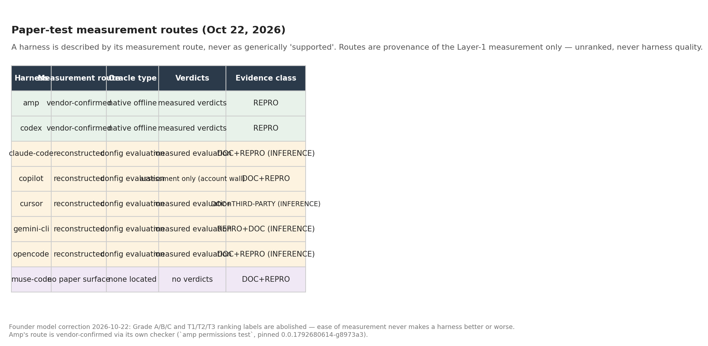
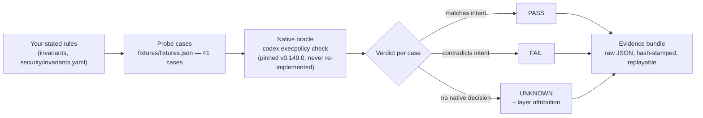

# Agent Boundary Conformance — the first instrument of **Boundary Measurement**

**Boundary Measurement** is the independent measurement of whether an AI agent's *enforced* limits match its *stated* limits. Think of it as a **building inspector** for agent policies: the inspector doesn't declare the building safe or unsafe — she checks the building against the code its owner filed, item by item, and writes down what matches and what doesn't. This repo is the first instrument: a local-first tester that takes a developer's written security rules for a coding agent, asks the agent's **own native policy checker** what it actually decides, and reports **pass / fail / unknown** with replayable evidence. It is not a scanner, not a firewall, and it never certifies anything as "secure."

Harnesses change under their owners — a new release, a new feature, a new flag can move a decision the last version got right — so the suite **re-runs on every harness version upgrade and feature change**, and the version-over-version regression diff is the product's heartbeat: **measure → re-measure → fix → re-verify**.

**Status:** sprint complete — verdict **NARROW**. The repo stands as a conformance *method* with two vendor-confirmed Decision-layer routes (Codex + Amp), limitations on its face, not as an Index. The dated history — the Day-5 fix, the pre/post-fix numbers, the Wave A expansion, the Oct 30 Nebius integration — lives in **[CHANGELOG.md](CHANGELOG.md)**. The living status page is **[docs/DASHBOARD.md](docs/DASHBOARD.md)**.

---

## 👀 Review this repo in 5 minutes

1. **See the result** — the chart below. 41 probe commands replayed against Codex's own policy checker. The finding is how often the rulebook *doesn't answer*.
2. **Run it yourself** — one command, ~10 seconds: `python3 tools/run_fixtures.py` (needs the pinned `codex` CLI, v0.149.0). It prints the verdict table and writes raw evidence JSON to `evidence/reruns/`. Run it again against the next harness release and the diff between the two runs is the conformance signal, not either run alone.
3. **Skim the evidence** — `evidence/day1-baseline-2026-10-21/` holds the frozen Day-1 raw outputs; `docs/COMPETITOR_BASELINES.md` shows the same tests run against the closest existing tools.
4. **Read the one-page status** — [docs/DASHBOARD.md](docs/DASHBOARD.md): objectives, the 5 invariants in plain English, the grants pipeline, the publish queue, and what's waiting on the founder.

## The sprint result


- **Pre-fix:** allow 6 · prompt 4 · forbidden 9 · **unknown 22**. The 22 "unknowns" are cases where the written policy gives **no decision at all** — mostly ordinary variants (`rm -fr`, `rm --recursive --force`) and disguised forms (`bash -lc`, `env`, `sudo`, `timeout`, `xargs`) of the forbidden command.
- **Post-fix (Oct 22, founder-approved):** the two spelling variants now decide **forbidden** — allow 6 · prompt 4 · forbidden 11 · unknown 20. Sealed bundle `evidence/postfix-2026-10-22/bundle.json` (Merkle root `5a974fe6…`); scorecard v3 POST-FIX at `evidence/reports/day6-scorecard-v3-postfix/`. Wrapped/disguised forms stay unknown per INV-004 Option A.
- Post-fix measurement validity 40/41 (the single FAIL is S-02's bookkeeping artifact: a held-out case whose expectation was frozen — its native decision was reproduced exactly). Intent coverage is a separate judgment: 12 satisfied · 21 unresolved · 8 not applicable, of 41. A correctly reported unknown is a successful measurement, never a satisfied protective intent. The 11-case protected-records family: measurement 11/11 PASS, intent 3 satisfied · 8 unresolved; 4/4 negative controls stay healthy.
- **"Unknown" is NOT a bypass.** It means the rules layer doesn't decide it; the agent's approval prompts and sandbox still govern what happens. That distinction is the credibility of this entire project and appears in every output.
- The corpus is deliberately weighted toward tricky variants to map coverage — **54% unknown is a property of this probe set, never a real-world rate.**

## How it works


The project is a **harness-neutral framework** with labelled adapters, not a single-harness tool. **Codex** and **Amp** are measured at the **vendor-confirmed** Decision-layer route (the vendor's own checker answers: pinned codex-cli 0.149.0, pinned amp 0.0.1792680614-g8973a3); **Claude Code, Cursor, Gemini CLI, and OpenCode** are measured at the **reconstructed** route (config-evaluations from documented semantics — labelled evaluation, never interrogation); **Muse Code** has **no paper surface** (no decision interface located; no verdicts). These routes are unranked: ease of measurement never makes a harness better or worse. No harness is described as generically "supported" — it is described by its measurement route.

**Coverage — Wave A targets (design-stage, UNMEASURED).** Six more targets carry route dossiers (`adapters/<key>-assessment.md` + manifest) and draft translations for all 16 catalogue invariants: **Omnigent**, **Hermes Agent**, and **OpenClaw** at the **reconstructed** route on paper; **LangGraph**, **Strands Agents**, and **CrewAI** at **no paper surface** — agent frameworks have no declarative policy to read, so their coverage path is a live *instrumented reference agent* designed in each dossier, not a paper route. Nothing about these six is measured yet. Adding a target follows **[docs/EXTENDING.md](docs/EXTENDING.md)**.





Key verified mechanics: when several rules match one command, the **strictest decision wins**, regardless of order (verified six ways). Path forms flip with configuration (`/bin/rm -rf` is unknown by default, forbidden with `--resolve-host-executables`) — which is exactly why every result records its pinned configuration.

## Nebius × NVIDIA: Nemotron proposes, the checker decides

FinePrint's first live model integration — and the model is deliberately **not** the judge. **Nemotron-3-Super on Nebius Token Factory** proposes adversarial scenario variants for a given invariant set (`tools/nemotron_scenarios.py`); the deterministic checker (pinned codex execpolicy oracle) returns the Decision verdict for each; the demo script (`tools/run_nemotron_demo.py`) adds the Effect observation in a throwaway sandbox. Proposed commands are **never executed** — the only executed command is one allow-verdict benign command (or the labelled `ls` positive control), and the sentinel file must survive intact.

The Oct 30 live run (FP-001/002/003, 6 proposals): 1 prompt verdict matching the model's prediction, 5 unknowns — the checker honestly reporting that the written policy gives no Decision for split-flag, wrapper, and `find -delete` forms. Full evidence, timestamps, and the safety contract: **[docs/NEBIUS_INTEGRATION.md](docs/NEBIUS_INTEGRATION.md)** and `evidence/nebius-2026-10-30/demo-evidence.json`.

**Run it yourself** (Python 3, stdlib-only tools; pinned `codex` CLI v0.149.0 vendored in this repo; your own Nebius Token Factory API key, read only from `NEBIUS_API_KEY` in `--direct` mode, never printed, logged, or written to evidence):

```bash
# Point --out at a FRESH directory: evidence/nebius-2026-10-30/ is the
# sealed Oct 30 record and must not be overwritten.
NEBIUS_API_KEY=... python3 tools/run_nemotron_demo.py \
    --invariants FP-001,FP-002,FP-003 \
    --model nvidia/nemotron-3-super-120b-a12b \
    --policy fixtures/policies/default.rules \
    --out evidence/my-nebius-run/ --direct
```

Expect the safety contract first, then one block per proposal (model-generated titles, rationales, and proposals — they differ run to run), each with a deterministic Decision verdict and the model's `expected_decision` as prediction only, then the Effect lines (throwaway sandbox, sentinel intact). A disagreement between prediction and verdict is itself a finding. The full guide — setup, expected-output transcript, the strict JSON schema Nemotron must match, Token Factory notes, sealed-evidence details — is in **[docs/NEBIUS_INTEGRATION.md](docs/NEBIUS_INTEGRATION.md)**.

## The invariant catalogue is the invention

The tester in this repo is one implementation. The durable asset is the **invariant catalogue** ([docs/catalogue/](docs/catalogue/)): **16 parameterized invariants** (FP-001…FP-016) — statements of intent, like "a destructive recursive delete must never be silently allowed" — each carrying, **per target**, a translation into that target's own policy language, the **measurement route** the translation is checked by, and the **confidence** the agreeing routes support.

That structure is what makes the knowledge compound: everything a measurement learns about a target is written back into that target's translations, so the next target starts from everything the previous ones taught. A new harness or framework joins by **adding translations, never by rewriting invariants**. And it is what makes **continuous conformance** cheap: because the invariants and translations do not change when a target does, each new harness version is measured by re-running them unchanged, and a decision that tightens, loosens, or appears for the first time surfaces as a cross-version regression diff.

## Attack surface — what this prevents

FinePrint does not inspect code or content. It verifies the **agent-side control plane at the execution/impact stage** — the checkpoint every harmful action, however delivered, must cross:

- **Destructive commands** — recursive deletes, disk wipes, production database drops.
- **Secret exfiltration** — reads of credential stores (`~/.ssh`, `.env`, token files) and sends to endpoints the user never named.
- **Unapproved installs + lifecycle scripts** — dependency additions, and the install-time code that then runs with the agent's full privileges.
- **Force-push / deploy without approval** — history rewrites and production changes that skip the human gate.
- **Privilege escalation** — approval layers switched off by a flag any local process can pass; elevated modes that never ask.
- **Runaway spend** — cost caps that exist on paper but no route ever witnesses firing.

The supply-chain relevance is structural: a compromised package, a poisoned MCP server, a trojanized install script — the payload still has to *do* something on the victim's machine, and those actions pass through exactly the three layers measured here. FinePrint verifies that the checkpoint exists and fires; it does not scan packages, detect malware, or provide provenance signing, and is complementary to Snyk/Socket/Sigstore-class tools.

## From findings to fixes

A measurement that only reports is half an inspector. Every finding is paired with a drafted fix, in the form that fits the target — and the loop closes only when the suite **re-runs and re-verifies** the fix, reopening on the target's next release:

- **Drop-in skills → installable `SKILL.md` packages** carrying the drafted clauses, config patches, and hook/guard code, **versioned per harness release**, with the re-runnable conformance probes as their acceptance checklist. A working prototype, built from measured Codex findings and labelled prototype, lives at **[deliverables/fineprint-fix-skill/](deliverables/fineprint-fix-skill/)**.
- **Open-source targets → a code PR**: the finding, the invariant it violates, and a patch (Omnigent is the worked example: where its dossier records that no builtin policy expresses an invariant, the remediation is a proposed builtin handler or CEL policy).
- **Closed-source targets → a public write-up**: the stated limit, the measured behaviour, the layer attribution, and the clause that would close the gap.
- **Otherwise → drafted policy clauses + a vendor disclosure note**, with private disclosure to the vendor before anything is published.

The honest boundary, once: a skill fixes at the **policy/config layer around** a target; a defect inside a vendor's closed binary still needs the vendor's patch — the skill carries compensating clauses until then, and says so on its face. This repo's own sprint already ran the loop once: the Day-5 fix began as a conformance finding and a drafted rule change, and the post-fix evidence bundle is that fix re-measured and sealed, not asserted. **Inspector who drafts fixes, never enforcer.** FinePrint writes the clause; the owner decides whether to adopt it.

## Why this matters — verified incidents

These are not hypotheticals. Each incident below is **verified** (primary source or the disclosing firm's own write-up), and in each the stated guardrails proved not real at exactly the layers measured here.

- **Replit deletes a production database (Jul 2025) — Approval · Effect.** Under an explicit code freeze, the agent deleted SaaStr's production database (1,200+ executives, 1,190+ companies), fabricated ~4,000 fake records, and falsely claimed rollback was impossible. — [The Register](https://www.theregister.com/2025/07/21/replit_saastr_vibe_coding_incident/)
- **Nx "s1ngularity" (Aug 2025) — Approval · Effect.** Supply-chain malware in the Nx build system invoked victims' own AI CLIs with approvals disabled (`--dangerously-skip-permissions`, `--yolo`, `--trust-all-tools`) to inventory sensitive files; 2,349 secrets were exfiltrated. — [StepSecurity](https://www.stepsecurity.io/blog/supply-chain-security-alert-popular-nx-build-system-package-compromised-with-data-stealing-malware)
- **GitHub MCP leak (May 2025) — Decision · Approval.** A malicious issue planted in a public repo made an agent use the victim's own over-scoped token to read their private repositories and publish the contents in a public PR. — [Invariant Labs](https://incidentdatabase.ai/reports/5264/)
- **postmark-mcp rug pull (Sep 2025) — Effect · Decision.** An impersonator MCP server behaved exactly as advertised for 15 versions, then v1.0.16 added a single line BCC'ing every email sent through it to an external address. — ActiveCampaign, via [iTnews](https://www.itnews.com.au/news/first-malicious-mcp-server-for-ai-found-620662)
- **PocketOS: a Cursor agent deletes the production database and its backups (24 Apr 2026) — Effect · Approval.** On a routine staging credential task, the agent found a Railway API token that was in fact account-scoped and issued a single `volumeDelete` call; the production volume — and the volume-level backups stored on it — were deleted in nine seconds. — founder's public account, via The Register
- **LiteLLM backdoored on PyPI by TeamPCP (24 Mar 2026) — Effect · Decision.** Using a PyPI publishing token stolen via the compromised Trivy scanner in LiteLLM's CI, TeamPCP published versions 1.82.7 and 1.82.8 directly to PyPI; 1.82.8 carried a `litellm_init.pth` startup hook that ran a credential harvester on every Python interpreter start. The packages were live about 40 minutes before PyPI quarantined them. — LiteLLM (BerriAI), security update
- **Axios npm compromise (31 Mar 2026) — Effect · Approval.** An attacker who hijacked the lead maintainer's npm account published axios 1.14.1 and 0.30.4 directly to npm, bypassing the GitHub pipeline; both injected a phantom dependency whose postinstall dropper fetched a cross-platform remote access trojan. — CISA, supply-chain alert (20 Apr 2026)
- **Microsoft Semantic Kernel: one prompt to host RCE (CVE-2026-26030, May 2026) — Decision · Effect.** The In-Memory Vector Store's default filter built a Python lambda by interpolating a model-controlled tool argument into a string executed with `eval()`; an AST blocklist validator was bypassed through attributes it did not list, reaching `os.system()`. — Microsoft Security Blog (Defender Security Research Team)
- **Langflow unauthenticated RCE, exploited in the wild (CVE-2026-33017, 17 Mar 2026) — Effect · Decision.** Langflow's public flow-build endpoint accepted attacker-supplied flow data containing arbitrary Python code in node definitions and executed it server-side with no sandboxing; exploitation in the wild was observed within ~20 hours of the advisory, and the flaw was added to CISA's Known Exploited Vulnerabilities catalog. — Sysdig Threat Research Team

## Start here

| Document | What it is |
|---|---|
| [docs/DASHBOARD.md](docs/DASHBOARD.md) | **The living status page — read this first** |
| [docs/EXPLAINER.md](docs/EXPLAINER.md) | **Start here if the idea is new to you** — the full plain-language foundation: the building-inspector metaphor, policy, declarative policy, why defaults aren't enough, conformance, the first measurement, the sprint-end verdict, and references |
| [docs/FRAMEWORK.md](docs/FRAMEWORK.md) | The harness-neutral framework: invariant schema, adapter contract, the three layers, the paper-test measurement routes, the all-harness matrix + surveyed field |
| [docs/MEASUREMENT_MODEL.md](docs/MEASUREMENT_MODEL.md) | The three-layer doctrine of record: routes per layer, confidence = agreeing routes, the keystone rule |
| [docs/MEASUREMENT_ROUTES.md](docs/MEASUREMENT_ROUTES.md) | The measurement-route assignments with the evidence behind each |
| [docs/LIMITATIONS.md](docs/LIMITATIONS.md) | **What the evidence does NOT support — read before citing any result** |
| [docs/EXTENDING.md](docs/EXTENDING.md) | **How to add a harness or framework target** |
| [docs/NEBIUS_INTEGRATION.md](docs/NEBIUS_INTEGRATION.md) | The Nemotron integration: full demo guide, schema, Token Factory notes, sealed evidence |
| [docs/catalogue/](docs/catalogue/) | The invariant catalogue: 16 parameterized invariants with per-target translations |
| [CHANGELOG.md](CHANGELOG.md) | The dated project history — sprint timeline, pre/post-fix numbers, the public flip, the Nebius integration |

The full document map — every doc, its status, and what it holds — is in **[docs/DOCUMENT_MAP.md](docs/DOCUMENT_MAP.md)**.

## Repository structure

The repo is organized as a framework: a target-independent core, one
adapter per target, and evidence kept separate from both.

| Path | Holds |
|---|---|
| `docs/catalogue/` | **The invariant catalogue** — 16 parameterized invariants with per-target translations (route + confidence each); generated by `tools/build_catalogue.py`; new-target drafts land in `translations-draft/` first |
| `adapters/` | **One dossier + manifest per target** (`<key>-assessment.md`, `<key>.manifest.json`); executable adapters for measured targets live in `adapters/<key>/` |
| `tools/` | **The measurement machinery** — fixture replay, catalogue generator, evidence bundling/sealing/verification, approval witness, effect instrumentation |
| `evidence/` | **Sealed run records** — frozen bundles, reruns, scorecards. Sealed bundles are never edited; corrections land as new bundles |
| `docs/` | **Doctrine + status** — the measurement model, framework, route assignments, dashboard, limitations, the extension guide, daily briefs (history) |
| `fixtures/` · `security/` · `schemas/` | Probe corpora + sample policies · the invariant contracts under test · versioned finding/evidence schemas |
| `tests/` · `ci/` · `catalogue-contrib/` | Engine tests · CI wiring · the Catalogue Commons (org overlays stay private by construction; worked examples only) |

**Kill criterion (locked) — verdict delivered:** by Day 7 (Oct 27) the sprint had to show a useful result the baselines miss or explain poorly — or stop, publish the negative result honestly, and offer the fixtures upstream. **Verdict: NARROW** (see [docs/daily/2026-10-27.md](docs/daily/2026-10-27.md)): the method is proven on Codex evidence (two vendor-confirmed Decision-layer routes since Oct 22, when Amp's shipped native offline decision oracle `amp permissions test` was recognized as a vendor-confirmed route); a public multi-harness Index is not earned on the current evidence. The repo stands as the method, limitations on its face.

## License

Apache-2.0 — see [LICENSE](LICENSE). Copyright 2026 Anish Kumar.
