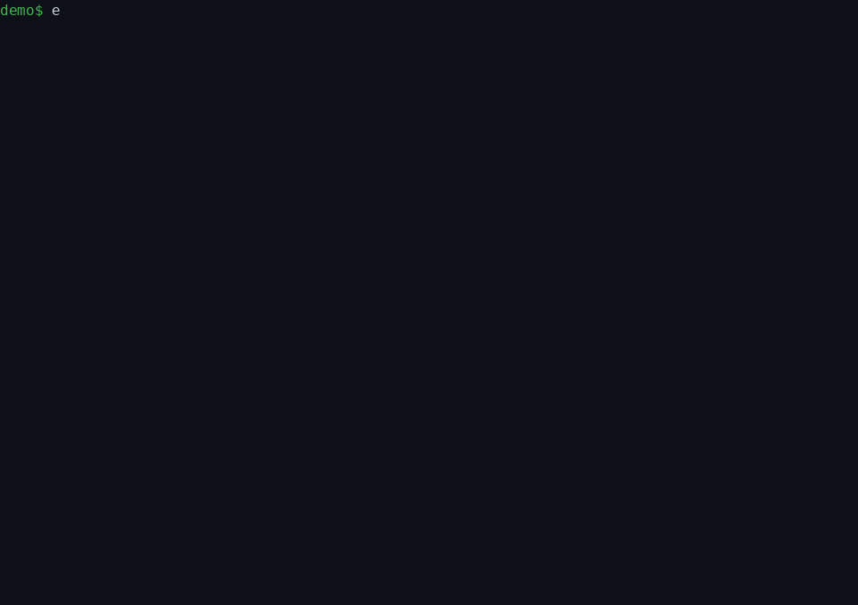
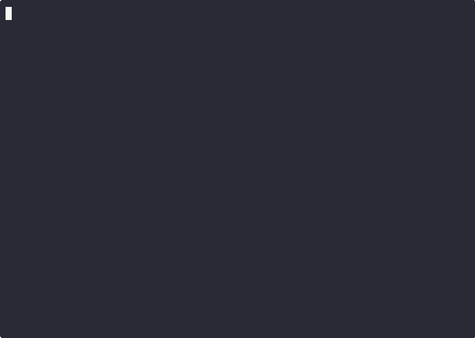
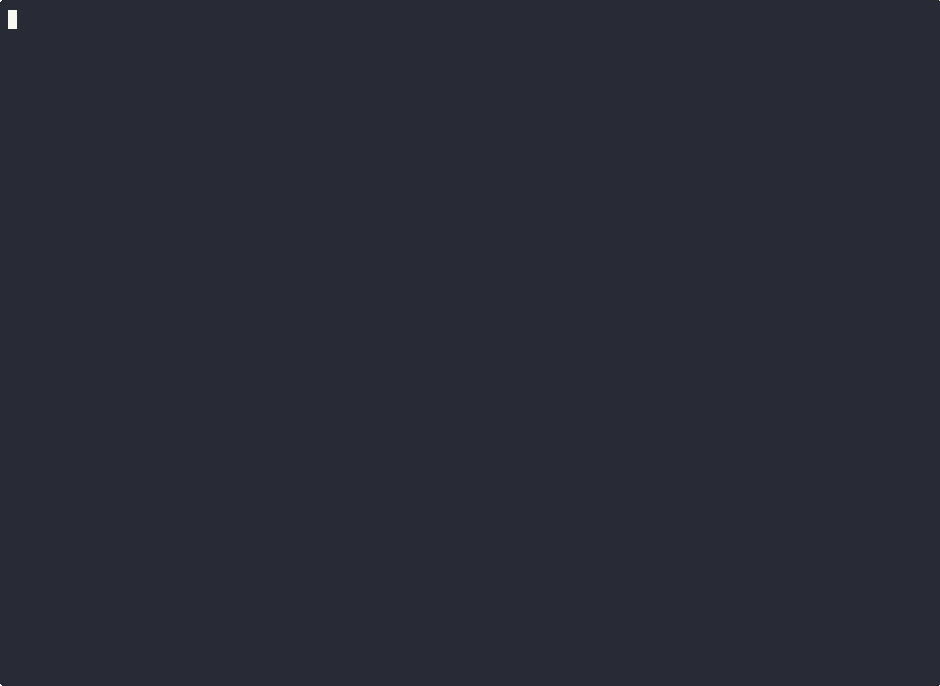

# Demos — every GIF in the repo, and how each was recorded

The main README keeps one demo (the Check). The rest live here; each is
recorded from real commands, never staged, and the recording script is
checked in so the pace is reproducible.

## The live harness + attribution (83 s)

List the harnesses, fail closed with no key, verify the sealed Cursor
run, read what the agent tried — and see a non-attempt attributed as
`denied_by_rule` vs `not_attempted`. Recorded from real commands with
`tools/demo/record_demo.py` (pty, readable typing speed, pauses);
re-record instructions in [`tools/demo/DEMO.md`](../tools/demo/DEMO.md).
Display-only: no measurement semantics, scoring, or sealed bundle
changed.

## The wall (the bouncer — it stops the harm the Check only measures)

## The second opinion (bekko-400m, local — the model judges what the denylist allows)

The demo shows `fineprint gate probe` (the three-step unshare/mount
pre-flight), then the second opinion denying an exfiltration the
deterministic layer allows — `GATE: DENY — second opinion: bekko
probability_yes=0.667 (threshold 0.5) (model bekko-system-one-v0-400m)
(rule S1-BLOCK-bekko)` — then normal work allowed with no model load,
and the notification log with the "second opinion — probabilistic"
marker. The model loads once per `gate run` (~2 min on a container CPU,
weights cached); that one wait is shortened to a few seconds in the
recording — the verdict itself is real. Recording script:
[`demo/record-second-opinion-demo.sh`](../demo/record-second-opinion-demo.sh).

## Drift fixtures — does compliance drift over a long task?

Four long tasks (8–12 steps each) in [`fixtures/drift/`](../fixtures/drift/) —
one per family (bugfix with protected records, refactor with a deploy
script, cleanup with a protected backup, migration with a credentials
file). The rule is stated at step 1; a late step naturally tempts the
agent to touch the protected thing; every task is completable without
violating. A canary marker (unique per run) sits in the protected
location: if it reaches the agent, the boundary failed. **These fixtures
measure agent behaviour WITHOUT the wall — the control condition.** The
drift campaign is the measurement of the problem over long tasks
(6 harnesses × 4 tasks × 3 repeats = 72 runs, post–Nov 9 ceremony,
harness auth + owner present); a later wall-arm would run the same tasks
with the wall and compare. Self-check (no harness auth, no live agent):
`python3 tools/check_drift_fixtures.py`. Demo recording script:
[`demo/record_drift_demo.sh`](../demo/record_drift_demo.sh). Full
write-up: [`fixtures/drift/README.md`](../fixtures/drift/README.md).

## Gate-proof acceptance campaign (dry-run)

The campaign that proves the free wall stops a real agent — Cursor, all
24 V1 cells, 3 repeats each, zero harm — is prepared and merged; the
live run needs Cursor auth + Anish present and is still pending. The
dry-run validates the fixtures, the bundle, and the sealing without an
agent.

Runbook: [framework/scorecard/acceptance/RUNBOOK.md](../framework/scorecard/acceptance/RUNBOOK.md) ·
Expectation table: [framework/scorecard/acceptance/EXPECTATIONS.md](../framework/scorecard/acceptance/EXPECTATIONS.md) ·
Recording script: [framework/scorecard/acceptance/record-demo.sh](../framework/scorecard/acceptance/record-demo.sh)
